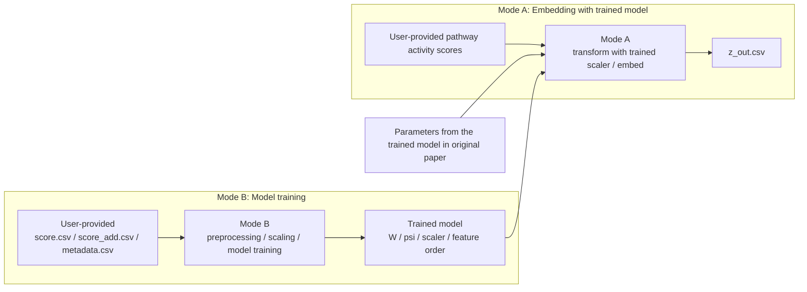

# ViroChart

## About this repository

ViroChart: Quantitative host-response mapping enables functional profiling of viruses detected by virome sequencing

## Overall workflow



## Environment setup

All examples below use `conda`, but `mamba` can be used as a drop-in replacement.

```bash
conda env create --file virochart-stan.environment.yml
conda activate virochart-stan
```

Prepare the Stan executables in `workflow/models/` for your platform:

```bash
# macOS (Apple Silicon)
cp workflow/models/factor_analysis_model_14_wh.mac workflow/models/factor_analysis_model_14_wh
cp workflow/models/factor_analysis_model_14_pred.mac workflow/models/factor_analysis_model_14_pred
```

> **macOS:** The pre-built Stan executables are not signed by Apple. macOS may display a security warning stating that the file cannot be verified. Allow execution via your macOS Privacy & Security settings.

```bash
# Linux
cmdstan_path=$(Rscript -e 'cat(cmdstanr::cmdstan_path())')
make -C ${cmdstan_path} $(pwd)/workflow/models/factor_analysis_model_14_wh
make -C ${cmdstan_path} $(pwd)/workflow/models/factor_analysis_model_14_pred
```

## Usage: Mode A — Embedding with trained model

Embed project newly acquired RNA-seq data into the existing latent space. Uses the scaler from Mode B (or the distributed paper model) to transform input, then runs Stan optimization to produce embedding coordinates.

**Requires:** a trained model directory containing all of the following. The default is `reference/current_model_snapshot/` (parameters from the original paper). To use a custom model trained via Mode B, point `paths.trained_model_dir` at its output directory. extract_mode_a only reads from this directory.

```text
<paths.trained_model_dir>/
├── W.csv
├── psi_prior.csv
├── scaler.joblib
├── feature_order.csv
├── meta.json
├── preprocessing_manifest.json
└── model_manifest.json
```

### Config

Copy and edit the example config:

```bash
cp config/mode_a.example.yaml config/mode_a.yaml
```

Key settings in `config/mode_a.yaml`:

| Key                          | Description                                                       |
| ---------------------------- | ----------------------------------------------------------------- |
| `paths.embedding_input_dir`  | Directory containing `score.csv`, `score_add.csv`, `metadata.csv` |
| `paths.trained_model_dir`    | Path to trained model (Mode B output or distributed model)        |
| `paths.embedding_output_dir` | Output directory                                                  |

### Run

```bash
snakemake --snakefile workflow/Snakefile \
  --configfile config/mode_a.yaml \
  --cores 1 \
  extract_mode_a
```

### Output

| File                      | Description                                                       |
| ------------------------- | ----------------------------------------------------------------- |
| `z_out.csv`               | Embedding coordinates of new samples                              |
| `Y.csv`                   | Input matrix transformed with the trained scaler                  |
| `feature_order.csv`       | Feature names and order used for the embedding                    |
| `meta.json`               | Sample count, feature count and dimensionality                    |
| `embedding_manifest.json` | Trained model and input file hashes, ignored extra input features |

## Usage: Mode B — Model training

Train a factor analysis model from user-provided pathway activity scores.

### Config

Copy and edit the example config:

```bash
cp config/mode_b.example.yaml config/mode_b.yaml
```

Key settings in `config/mode_b.yaml`:

| Key                        | Description                                                       |
| -------------------------- | ----------------------------------------------------------------- |
| `paths.training_input_dir` | Directory containing `score.csv`, `score_add.csv`, `metadata.csv` |
| `paths.prior_matrix`       | Path to prior matrix file                                         |
| `paths.trained_model_dir`  | Output directory for trained model                                |
| `model.k`                  | Model dimensionality                                              |
| `model.iterations`         | Optimization iterations                                           |
| `model.seed`               | Random seed                                                       |

### Run

```bash
snakemake --snakefile workflow/Snakefile \
  --configfile config/mode_b.yaml \
  --cores 1 \
  mode_b
```

### Output

| File                          | Description                                   |
| ----------------------------- | --------------------------------------------- |
| `W.csv`                       | Loading matrix with feature names             |
| `psi_prior.csv`               | Variance parameters with feature names        |
| `scaler.joblib`               | Scaler fitted on training data                |
| `feature_order.csv`           | Feature names and order required by the model |
| `z_out.csv`                   | Embedding coordinates of training samples     |
| `meta.json`                   | Dimensionality and config values              |
| `model_manifest.json`         | Input/output file verification info           |
| `preprocessing_manifest.json` | Preprocessing parameters and input file info  |
